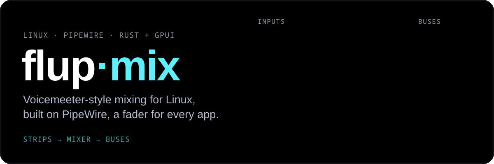
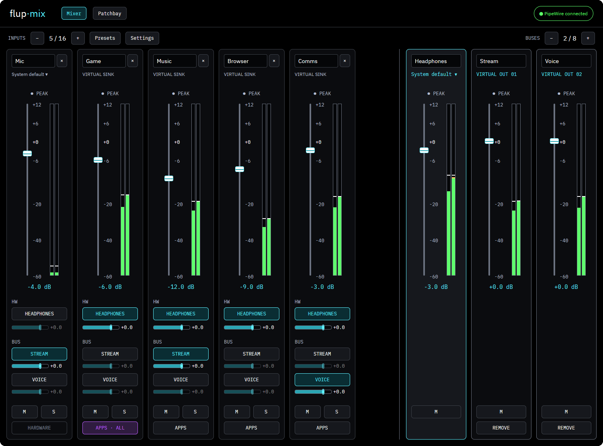
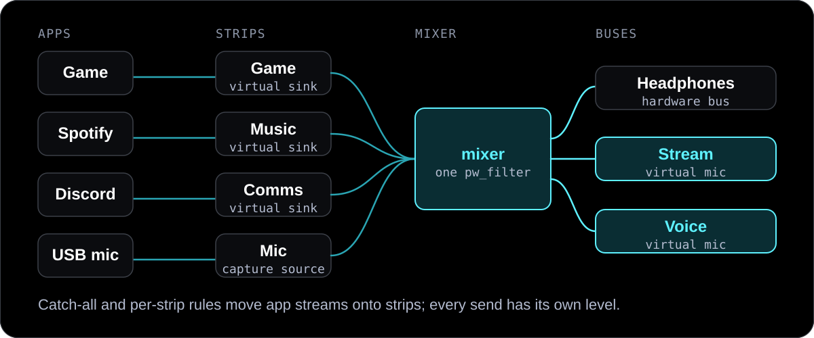
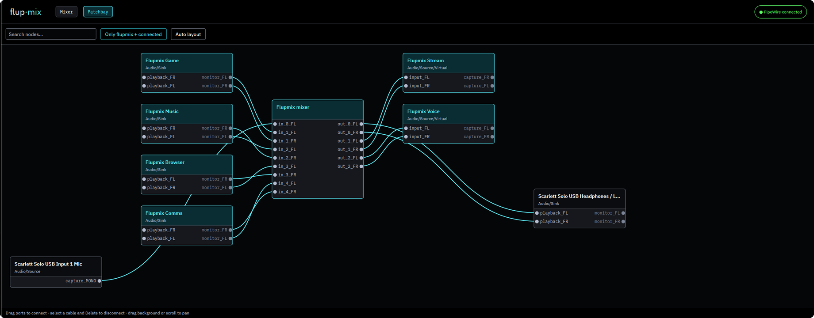

<p align="center">
  
</p>

<p align="center">
  <a href="https://github.com/Niller2005/flupmix/releases/latest"><b>Download</b></a> ·
  <a href="#install">Install</a> ·
  <a href="#first-run">First run</a> ·
  <a href="CHANGELOG.md">Changelog</a>
</p>

<p align="center">
  
</p>

flupmix is an audio mixer for Linux in the spirit of Voicemeeter. Think
[jack_mixer](https://rdio.space/jackmixer/) for the mixing and
[qpwgraph](https://gitlab.freedesktop.org/rncbc/qpwgraph) for the patching, in
one window, on PipeWire, without JACK. The interface is written in Rust with
[GPUI](https://github.com/zed-industries/zed/tree/main/crates/gpui).

- **Strips for your apps.** Give games, music, the browser and chat each their own fader, mute and solo, and play them all to your headphones.
- **Virtual microphones.** Mix any combination of strips into a bus that OBS, Discord or a browser can pick as a microphone.
- **A level for every send.** Each strip has its own level into the hardware bus and into every virtual bus.
- **Routing without lists of every game.** Make one strip the catch-all, then only list the exceptions: assign Spotify to Music, block it from Game.
- **Presets and a patchbay.** Save the whole mixer by name, or open the qpwgraph-style graph to see and change every link.




A **strip** is either a virtual sink that applications play into (Game, Music,
...) or a hardware capture source such as your microphone. All strips enter a
single PipeWire filter node that mixes them in one real-time callback, the way
jack_mixer does. The result goes to one **hardware bus** (the system default
sink, or any sink you choose) and to up to eight **virtual buses**, which other
applications see as `Audio/Source/Virtual` microphones.

The engine is declarative: whenever the mixer changes, it is reconciled against
the live PipeWire registry (create missing nodes, link what should be linked,
move application streams). On exit it hands routed applications back to the
system default.

Apps are matched to strips by process binary or application name. An explicit
assignment wins, then the catch-all strip takes whatever is left unless that
strip blocks it.

<p align="center">
  
</p>


Every [release](https://github.com/Niller2005/flupmix/releases/latest) has an
AppImage and a tarball (x86_64 Linux), each with a `.sha256`.

```sh
chmod +x flupmix-*-x86_64.AppImage
./flupmix-*-x86_64.AppImage
```

The AppImage contains only the binary. PipeWire, Wayland or X11, and Vulkan or
GL drivers come from your system, and it needs a glibc as new as Ubuntu 24.04's.

To get flupmix into your app menu, unpack the tarball and run the installer
(or run it from a checkout, where it builds from source):

```sh
./install.sh             # installs under ~/.local
./install.sh uninstall   # removes it again
```

`PREFIX=/usr/local sudo -E ./install.sh` installs system-wide.

<details>
<summary>Build from source</summary>

You need stable Rust, the PipeWire development headers, and `clang` for bindgen.

```sh
cargo run --release -p flupmix
```

`cargo run -p flupmix-engine --example headless` runs the engine without the UI
and prints meters, which helps when debugging.

| crate | role |
| --- | --- |
| `flupmix-core` | Mixer model, dB taper, mixing kernel, app-routing rules, config, presets, settings. No audio-server dependency; unit tested. |
| `flupmix-engine` | The PipeWire thread: mixer node, virtual sinks and sources, link reconciliation, app routing. |
| `flupmix-ui` | The GPUI interface. |
| `flupmix` | The binary that wires everything together, plus the system tray. |

To release: move the *Unreleased* entries in `CHANGELOG.md` into a new
`## [x.y.z] - date` section, bump `version` in the workspace `Cargo.toml`, and
push a tag `vx.y.z`. The release workflow checks that all three agree, builds,
tests, and publishes the tarball and AppImage with that changelog section as the
release notes.

</details>

## First run

1. Start flupmix. The first launch creates a starter layout: a mic strip, Game, Music, Browser, Desktop and Comms strips, and two virtual buses.
2. Game starts as the **catch-all**, so all app audio moves onto it. Open **APPS** on a strip to assign or block running apps.
3. In an app such as OBS or Discord, pick a flupmix bus as the microphone, and send strips to that bus with its button.

Settings (tray behaviour, launch at login, meters, fader feel, palette, window
size, shortcuts) and Presets open from the mixer header. Everything lives under
`~/.config/flupmix/`: `config.toml` for the mixer, `settings.toml` for settings,
`presets/` for presets. Closing the window keeps the mixer running in the system
tray; without a tray host, closing quits.


- Stereo only. Mono sources are duplicated to both channels.
- In the patchbay, a link that flupmix manages comes back if you delete it; use the strip buttons instead.
- Links you create in the patchbay survive flupmix exiting; flupmix's own links and nodes do not.
- Shortcuts only work while the window is focused (Wayland offers no global hotkeys without a portal).

## Licence

MIT, see [LICENSE](LICENSE). Bundled fonts: IBM Plex Sans and Lilex, both under the SIL Open Font License (`assets/fonts/`).
